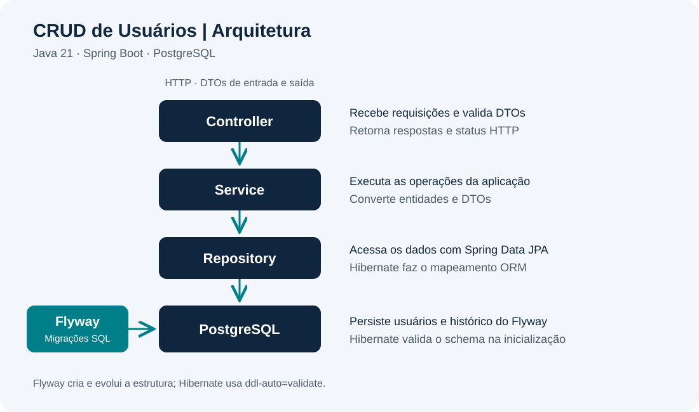
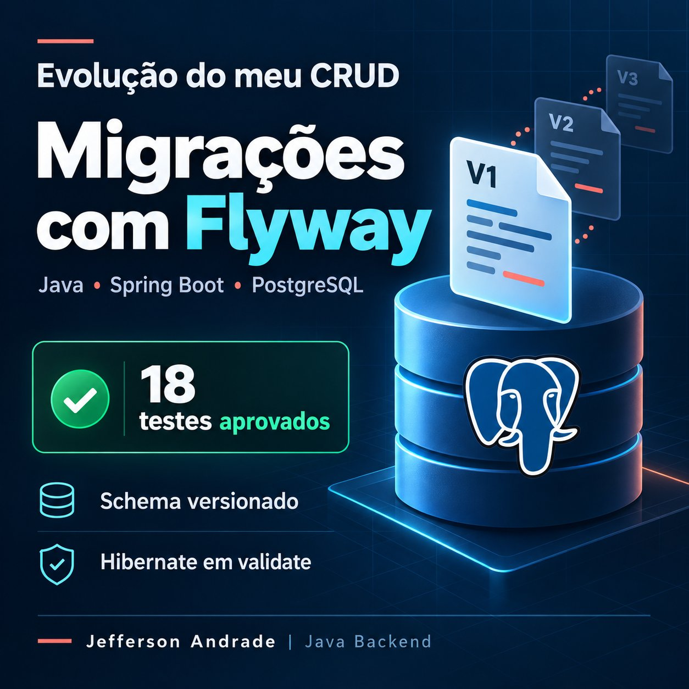

# 🚀 CRUD de Usuários — API REST

[](https://github.com/Jefferson-Andrade/CRUD-de-Usuarios-API-REST/actions/workflows/ci.yml)

> API REST para gerenciamento de usuários, desenvolvida com **Java 21** e **Spring Boot 4.1.1**, aplicando conceitos de desenvolvimento backend, arquitetura em camadas, DTOs, validação, persistência de dados e testes automatizados.

---

## 🛠️ Tecnologias

| Tecnologia | Utilização |
|---|---|
| ☕ **Java 21** | Linguagem principal |
| 🌱 **Spring Boot 4.1.1** | Framework backend |
| 🌐 **Spring Web MVC** | Desenvolvimento da API REST |
| 🗃️ **Spring Data JPA** | Persistência de dados |
| 🐘 **PostgreSQL 16** | Banco de dados |
| **Flyway** | Migrações SQL versionadas e histórico do schema |
| 🐳 **Docker / Docker Compose** | Containerização do banco |
| 📖 **OpenAPI / Swagger** | Documentação e testes da API |
| 🧪 **JUnit Jupiter** | Testes automatizados |
| 🎭 **Mockito** | Testes unitários |
| 🗄️ **H2** | Banco em memória para o teste de contexto |
| 🧰 **Testcontainers** | PostgreSQL temporário nos testes de integração |
| ✅ **Maven Failsafe** | Execução e verificação dos testes de integração |
| 📦 **Maven** | Gerenciamento e build |
| 🔧 **Git / GitHub** | Versionamento |

---

## 📋 Sobre o projeto

Este projeto consiste em uma API REST para gerenciamento de usuários, implementando as principais operações de um CRUD:

- ✅ Criação de usuários
- ✅ Consulta de usuários
- ✅ Consulta por ID
- ✅ Atualização de usuários
- ✅ Exclusão de usuários
- ✅ Validação dos dados de entrada
- ✅ Tratamento global de exceções
- ✅ Persistência com PostgreSQL
- ✅ Migrações SQL com Flyway e validação do schema pelo Hibernate
- ✅ Documentação com Swagger / OpenAPI
- ✅ Testes automatizados
- ✅ Testes de integração com PostgreSQL real e Testcontainers

O projeto foi desenvolvido com foco em organização, separação de responsabilidades e aplicação de boas práticas de desenvolvimento backend.

---

## 🏗️ Arquitetura

A aplicação utiliza uma arquitetura em camadas:



### Camadas

**Controller**  
Responsável por receber as requisições HTTP e retornar as respostas da API.

**Service**  
Concentra a lógica de negócio da aplicação.

**Repository**  
Responsável pelo acesso e persistência dos dados através do Spring Data JPA.

**DTOs**  
Utilizados para controlar os dados de entrada e saída da API, evitando a exposição direta da entidade JPA.

---

## 🔌 Endpoints

| Método | Endpoint | Descrição | Status |
|:---:|---|---|:---:|
| 🟢 **POST** | `/users` | Criar usuário | `201 Created` |
| 🔵 **GET** | `/users` | Listar usuários com paginação, ordenação e busca por nome | `200 OK` |
| 🔵 **GET** | `/users/{id}` | Buscar usuário por ID | `200 OK` |
| 🟡 **PUT** | `/users/{id}` | Atualizar usuário | `200 OK` |
| 🔴 **DELETE** | `/users/{id}` | Excluir usuário | `204 No Content` |

---

## 📥 Exemplos de requisições

### Criar usuário

**POST `/users`**

```json
{
  "name": "Jefferson Andrade"
}
```

### Resposta

```json
{
  "id": 1,
  "name": "Jefferson Andrade"
}
```

---

### Buscar usuário

**GET `/users/1`**

```json
{
  "id": 1,
  "name": "Jefferson Andrade"
}
```

---

### Atualizar usuário

**PUT `/users/1`**

```json
{
  "name": "Jefferson Andrade Atualizado"
}
```

### Resposta

```json
{
  "id": 1,
  "name": "Jefferson Andrade Atualizado"
}
```

---

### Listar usuários: paginação, ordenação e busca

**Mudança de contrato:** `GET /users` retorna um objeto com `content` e metadados, inclusive sem parâmetros. Antes retornava um array na raiz. Consumidores devem passar a ler `response.content`. POST, GET por ID, PUT e DELETE mantêm seus contratos. Não existe listagem ilimitada alternativa.

| Parâmetro | Padrão | Regra |
|---|---|---|
| `page` | `0` | Inteiro a partir de zero |
| `size` | `10` | Inteiro de 1 a 100 |
| `sort` | `id,asc` | Um único par: `id,asc`, `id,desc`, `name,asc` ou `name,desc` |
| `name` | Sem filtro | Até 255 caracteres recebidos; espaços nas pontas são removidos; vazio não filtra |

A busca é parcial e ignora maiúsculas/minúsculas, sem remover acentos. Os caracteres `%` e `_` são tratados literalmente pela consulta derivada do Spring Data JPA. A ordenação por nome usa ID como desempate **na mesma direção**: `name,asc` usa `name ASC, id ASC`; `name,desc` usa `name DESC, id DESC`.

Exemplos:

```http
GET /users
GET /users?page=0&size=2&sort=name,asc
GET /users?name=Jefferson&page=0&size=10
GET /users?page=1&size=5&sort=id,desc
```

Para uma base com Ana, Bruno e Carla, em ordem de ID, `GET /users?page=0&size=2` retorna:

```json
{
  "content": [
    {
      "id": 1,
      "name": "Ana"
    },
    {
      "id": 2,
      "name": "Bruno"
    }
  ],
  "page": 0,
  "size": 2,
  "totalElements": 3,
  "totalPages": 2,
  "first": true,
  "last": false
}
```

Os totais refletem o filtro. Sem resultados, retorna HTTP 200 com `content: []`, `totalElements: 0` e `totalPages: 0`. Uma página além da última também retorna 200 e conteúdo vazio, preservando os totais reais. `first` indica índice zero e `last` indica ausência de página seguinte.

Retorna **400 Bad Request**, no padrão `status`, `error`, `message` e `timestamp`, para página negativa, tamanho fora da faixa, números inválidos ou fora do intervalo de um inteiro Java, offset (`page × size`) acima de 2.147.483.647 (limite do JPA), parâmetros de paginação vazios, filtro acima de 255 caracteres e sort inválido ou repetido. Exemplos inválidos: `size=101`, `page=abc`, `sort=email,asc` e `sort=name,asc&sort=id,desc`. A validação ocorre antes da criação do Pageable; falhas inesperadas não são convertidas em 400.

A paginação e o filtro são executados pelo PostgreSQL através de `findAll(Pageable)` ou `findByNameContainingIgnoreCase(name, pageable)`. A aplicação converte somente os resultados da página para DTOs e usa `PageResponseDTO` como contrato público, sem expor a serialização interna de `PageImpl`.

Esta melhoria não altera a tabela nem a migração V1. Busca parcial e contagem de totais ainda podem percorrer muitos registros; medir antes de propor índices. Paginação por offset não fornece um snapshot: inserções, alterações ou exclusões concorrentes podem mudar a composição das páginas entre requisições.

Referência: [Spring Data JPA — Query Methods](https://docs.spring.io/spring-data/jpa/reference/jpa/query-methods.html).

---

### Excluir usuário

**DELETE `/users/1`**

```text
204 No Content
```

---

# 📸 Demonstração

## Swagger / OpenAPI

Documentação interativa da API através do Swagger UI.


---

## Criando um usuário

Exemplo de execução do endpoint `POST /users`.


---

## Excluindo um usuário

Exemplo de execução do endpoint `DELETE /users/{id}`.


---

# 📖 Documentação da API

Com a aplicação em execução:

### Swagger UI

```text
http://localhost:8080/swagger-ui/index.html
```

### OpenAPI JSON

```text
http://localhost:8080/v3/api-docs
```

O Swagger permite visualizar os endpoints, modelos de dados e executar requisições diretamente pela interface web.

---

# 🗄️ Banco de dados

O projeto utiliza **PostgreSQL 16** para persistência dos usuários.

### Configuração

```text
Database: crud
Username: postgres
Password: postgres
Host: localhost
Port: 5432
```

A comunicação com o banco é realizada através do **Spring Data JPA**.

### Migrações com Flyway

<p align="center">
  
</p>

*Ilustração da melhoria implementada. A migração disponível é a V1; V2 e V3 representam evoluções futuras. A validação dos 18 testes foi realizada em PostgreSQL temporário, sem aplicar baseline no banco local.*

[Ver execução aprovada no GitHub Actions](https://github.com/Jefferson-Andrade/CRUD-de-Usuarios-API-REST/actions/runs/39037493707).

O **Flyway** cria e evolui a estrutura através de scripts em `src/main/resources/db/migration`. O Hibernate apenas valida o mapeamento das entidades:

```properties
spring.jpa.hibernate.ddl-auto=validate
spring.flyway.enabled=true
spring.flyway.locations=classpath:db/migration
spring.flyway.baseline-on-migrate=false
```

A migração `V1__create_users_table.sql` cria `users` com `id BIGINT GENERATED BY DEFAULT AS IDENTITY PRIMARY KEY` e `name VARCHAR(255)` nullable, preservando o mapeamento atual. Em um banco vazio, inicie a aplicação normalmente: o Flyway aplica a V1 antes da validação JPA. Em novas inicializações, as versões aplicadas são conferidas e não são executadas novamente.

Confira o histórico:

```powershell
docker compose exec db psql -U postgres -d crud -c "SELECT version, description, type, success FROM public.flyway_schema_history ORDER BY installed_rank;"
```

**Não edite migrações já aplicadas.** Para mudanças futuras, adicione `V2__descricao.sql`, `V3__descricao.sql` etc., com dois sublinhados. Flyway detecta alterações de checksum. Não use `repair` para ocultar divergências.

### Adoção em um banco existente

Se o volume já contém a tabela `users`, a primeira inicialização será interrompida até a adoção explícita. A baseline registra o ponto de partida; **não verifica nem corrige a estrutura existente**. Não habilite `baseline-on-migrate` globalmente e não execute `docker compose down -v`.

1. Pare a aplicação e outras gravações. Confirme o banco, schema e conexão de destino. O procedimento abaixo usa o Compose deste repositório (`crud`, usuário `postgres`, schema `public`).
2. Gere backup e copie-o para o host. Os comandos evitam redirecionar bytes binários pelo PowerShell:

```powershell
docker compose exec db pg_dump -U postgres -d crud -Fc -f /tmp/crud_before_flyway.dump
docker compose cp db:/tmp/crud_before_flyway.dump ./crud_before_flyway.dump
```

Guarde esse backup fora do repositório. Não sobrescreva um backup anterior; use um nome diferente para cada execução.

3. Restaure em **outro banco vazio**, usando um nome ainda não existente, e confira o resultado. Exemplo de cópia de validação:

```powershell
docker compose exec db createdb -U postgres crud_flyway_check
docker compose exec db pg_restore -U postgres -d crud_flyway_check --no-owner --exit-on-error /tmp/crud_before_flyway.dump
docker compose exec db psql -U postgres -d crud_flyway_check -c "\d+ public.users"
docker compose exec db psql -U postgres -d crud_flyway_check -c "SELECT id, name FROM public.users ORDER BY id;"
```

Compare a estrutura com a V1: chave primária `id bigint`, geração de ID identity (`BY DEFAULT` ou equivalente compatível), `name character varying(255)` nullable, schema `public`. Confira também outras tabelas/objetos existentes, sequências e quantidade de registros. Resolva diferenças antes da baseline; não adapte a V1 aplicada em outros ambientes para esconder divergências.

4. Com o **Flyway CLI instalado**, registre a baseline primeiro na cópia. Use uma versão compatível com a dependência gerenciada no POM efetivo (`./mvnw help:effective-pom`). No PowerShell, configure a senha somente para esta sessão:

```powershell
$env:FLYWAY_PASSWORD = 'postgres'
flyway -url=jdbc:postgresql://localhost:5432/crud_flyway_check -user=postgres -schemas=public -defaultSchema=public -baselineVersion=1 baseline
Remove-Item Env:FLYWAY_PASSWORD
```

Inicie a aplicação contra a cópia, sem alterar a conexão padrão do projeto:

```powershell
.\mvnw.cmd spring-boot:run "-Dspring-boot.run.arguments=--spring.datasource.url=jdbc:postgresql://localhost:5432/crud_flyway_check"
```

Confira `flyway_schema_history` nessa cópia: versão `1`, tipo `BASELINE`, sucesso. A V1 não será executada sobre a tabela existente. Confira IDs, nomes, contagem e geração de novos IDs, exercite o CRUD e reinicie a aplicação. Compare os registros anteriores antes de aceitar a adoção.

5. Somente depois dessa validação, pare a aplicação e faça a mesma operação explícita no banco original (`-url=jdbc:postgresql://localhost:5432/crud`), conferindo novamente o destino e mantendo o backup. Inicie normalmente e verifique histórico e dados. Este procedimento exige acesso e inspeção do banco local; os testes automatizados usam apenas bancos temporários.

Referências: [Spring Boot — Database Initialization](https://docs.spring.io/spring-boot/how-to/data-initialization.html) e [Flyway — baseline](https://documentation.red-gate.com/fd/baseline-277578974.html).

---

# 🐳 Docker

O PostgreSQL é executado utilizando Docker Compose.

### Iniciar o banco

```bash
docker compose up -d
```

### Verificar o container

```bash
docker compose ps
```

### Parar o banco

```bash
docker compose down
```

---

# 🧪 Testes automatizados

A suíte utiliza **JUnit Jupiter**, **Mockito**, **MockMvc**, **Spring Boot Test**, **H2** e **Testcontainers**. Os testes com mocks verificam comportamentos isolados; os testes de integração percorrem as camadas da aplicação e verificam a persistência em PostgreSQL real.

### Organização da suíte

| Classe | Tipo | O que verifica | Testes |
|---|---|---|:---:|
| `UserServiceTest` | Unitário, com repository mockado | CRUD, filtro normalizado, seleção da consulta paginada, conversão dos DTOs e metadados | 9 |
| `UserControllerTest` | Web, com service mockado | CRUD, padrões e parâmetros de listagem, limites, erros 400 e falhas inesperadas | 30 |
| `CrudApplicationTests` | Contexto, com H2 em memória | Carregamento da aplicação | 1 |
| `UserPostgresIT` | Integração, com PostgreSQL 16 e sem mocks | CRUD, paginação, busca, ordenação, OpenAPI e regressão de Flyway | 12 |
| **Total** | | | **52** |

### Executar os testes sem Docker

Windows (PowerShell):

```powershell
.\mvnw.cmd test
```

Linux/macOS:

```bash
./mvnw test
```

Esses comandos executam **40 testes**: os testes de serviço e de controller com mocks e o teste de contexto com H2. Não exigem PostgreSQL ou Docker.

### Executar a suíte completa com PostgreSQL

Pré-requisitos: Java 21 e Docker acessível. No Windows, mantenha o Docker Desktop em execução com containers Linux.

Windows (PowerShell):

```powershell
.\mvnw.cmd -Pintegration verify
```

Linux/macOS:

```bash
./mvnw -Pintegration verify
```

O perfil `integration` executa os 40 testes convencionais e os 12 testes `UserPostgresIT`, totalizando **52 testes**. O Maven Failsafe executa as classes `*IT` e verifica o resultado na etapa `verify`.

Não é necessário iniciar o banco com `docker compose up`. O Testcontainers cria um PostgreSQL temporário com a imagem `postgres:16-alpine`, banco `crud_integration` e porta aleatória, separado do banco da aplicação. A primeira execução pode baixar as imagens necessárias. A suíte falha se o Docker não estiver acessível.

### Cenários de integração

- **Paginação e busca:** primeira/segunda página sem sobreposição, totais filtrados, página além do fim, filtro parcial sem diferenciar caixa, filtros vazios e sem resultados, ordenação asc/desc com desempate por ID e busca literal por `%` e `_`.
- **OpenAPI:** contrato paginado, parâmetros e limites conferidos no documento gerado em `/v3/api-docs`.

- **Criação, consulta e listagem:** POST retorna `201` e um ID gerado; consultas SQL conferem o nome e a quantidade de registros; GET por ID e listagem retornam os dados salvos.
- **Atualização:** PUT retorna `200`, mantém o ID e altera o nome; uma consulta SQL e um novo GET confirmam a alteração persistida, sem criar outro usuário.
- **Exclusão:** DELETE retorna `204` com corpo vazio; uma consulta SQL confirma a remoção; GET posterior retorna `404` com os campos de erro esperados, e a listagem fica vazia.

- **Migrações:** a inicialização usa Flyway com Hibernate em `validate`; o histórico registra a V1. Uma nova instância de Flyway não reaplica a migração e preserva os dados.
- **Baseline:** um schema isolado com dados preexistentes recusa adoção automática. A baseline explícita na versão 1 preserva IDs, nomes, contagem e geração de novos IDs. Esse cenário não substitui a inspeção do banco local.

As requisições usam MockMvc com a aplicação completa, passando por **controller → service → repository → PostgreSQL**. Não há mocks nem uma transação de teste envolvendo as requisições; as consultas SQL verificam as gravações confirmadas no banco.

Os dados são limpos antes de cada teste. O PostgreSQL é declarado como um bean de teste com `@ServiceConnection`, que fornece os dados de conexão ao Spring Boot. Ao final da classe, o Spring encerra a aplicação e as conexões antes de parar o container.

### Resultado histórico (antes do Flyway)

Na execução de **05/10/2026**, a suíte completa terminou com **`BUILD SUCCESS`**:

- **13 testes existentes:** nenhuma falha, erro ou teste ignorado.
- **3 testes de integração com PostgreSQL:** nenhuma falha, erro ou teste ignorado.
- Encerramento normal das conexões, sem o erro anterior de finalização do processo.

Os relatórios ficam em `target/surefire-reports` para os testes existentes e em `target/failsafe-reports` para os testes de integração.

---

### Integração contínua com GitHub Actions

O workflow [CI - Testes do CRUD](https://github.com/Jefferson-Andrade/CRUD-de-Usuarios-API-REST/actions/workflows/ci.yml), definido em `.github/workflows/ci.yml`, executa a suíte completa:

- A cada push na branch `master`.
- Em pull requests destinados à `master`.
- Manualmente pela aba **Actions → CI - Testes do CRUD → Run workflow**.

O job **Testes do CRUD** utiliza Ubuntu, Java 21 Temurin, cache de dependências Maven e Docker para Testcontainers. Ele compila, executa os testes convencionais e os testes de integração com PostgreSQL temporário usando:

```bash
bash ./mvnw -B -ntp -Pintegration verify
```

No Windows (PowerShell), o comando equivalente é:

```powershell
.\mvnw.cmd -B -ntp -Pintegration verify
```

Não é necessário iniciar o PostgreSQL com Docker Compose para essa suíte. Uma falha de compilação, de teste ou de infraestrutura deixa o job com status de falha.

Os relatórios Surefire e Failsafe produzidos são enviados como o artefato **relatorios-testes-crud**, mesmo quando os testes falham, e ficam disponíveis por **14 dias**. Se a execução falhar antes de gerar relatórios, consulte os logs das etapas. Para conferir o resultado, abra a execução na aba **Actions** e baixe o artefato.

A suíte atual possui **52 testes** (40 convencionais e 12 de integração), validados localmente em 21/10/2026 com `BUILD SUCCESS`, sem falhas, erros ou testes ignorados. O workflow executa os mesmos comandos; confira o status do commit correspondente na aba Actions. Historicamente, eram 16 testes no commit `1a934d2` e 18 após a integração inicial do Flyway. Conforme novos cenários forem adicionados, atualize a quantidade a partir dos relatórios reais.

---

# ✅ Validação e tratamento de exceções

A API utiliza **Bean Validation** para validar os dados recebidos nas requisições.

Também possui tratamento global de exceções através de um `GlobalExceptionHandler`.

Quando um usuário não é encontrado, é lançada uma exceção personalizada:

```text
UserNotFoundException
```

A aplicação então retorna uma resposta HTTP adequada ao cenário.

---

# 📦 DTOs

A API utiliza DTOs para separar os dados recebidos e enviados pela aplicação.

### UserRequestDTO

Utilizado para criação e atualização:

```json
{
  "name": "Jefferson Andrade"
}
```

### UserResponseDTO

Utilizado nas respostas:

```json
{
  "id": 1,
  "name": "Jefferson Andrade"
}
```

Essa abordagem evita expor diretamente a entidade JPA através da API.

---

# 📁 Estrutura do projeto

```text
CRUD-de-Usuarios-API-REST
│
├── src
│   ├── main
│   │   ├── java
│   │   │   └── com.example.crud
│   │   │       ├── controller
│   │   │       ├── dto
│   │   │       ├── exception
│   │   │       ├── model
│   │   │       ├── repository
│   │   │       └── service
│   │   │
│   │   └── resources
│   │       ├── application.properties
│   │       └── db/migration/V1__create_users_table.sql
│   │
│   └── test
│       ├── java
│       │   └── com.example.crud
│       │       ├── CrudApplicationTests.java
│       │       ├── UserControllerTest.java
│       │       ├── UserServiceTest.java
│       │       └── UserPostgresIT.java
│       │
│       └── resources
│           └── application.properties
│
├── docker-compose.yaml
├── pom.xml
├── mvnw
├── mvnw.cmd
└── README.md
```

---

# ▶️ Como executar

## Pré-requisitos

- Java 21
- Docker Desktop
- Git

## 1. Clone o repositório

```bash
git clone https://github.com/Jefferson-Andrade/CRUD-de-Usuarios-API-REST.git
```

Entre na pasta:

```bash
cd CRUD-de-Usuarios-API-REST
```

## 2. Inicie o PostgreSQL

```bash
docker compose up -d
```

Se o volume já possui dados, siga **Adoção em um banco existente** antes de iniciar a aplicação com esta versão.

## 3. Execute a aplicação

No Windows:

```bash
.\mvnw.cmd spring-boot:run
```

Ou:

```bash
mvn spring-boot:run
```

A aplicação será executada em:

```text
http://localhost:8080
```

## 4. Acesse o Swagger

```text
http://localhost:8080/swagger-ui/index.html
```

---

# 💡 Boas práticas aplicadas

- Arquitetura em camadas
- Separação de responsabilidades
- DTOs para entrada e saída
- Injeção de dependências por construtor
- Bean Validation
- Tratamento global de exceções
- Exceção personalizada
- Status HTTP adequados
- Spring Data JPA
- PostgreSQL
- Docker Compose
- Testes unitários
- Testes Web com MockMvc
- H2 para o teste de contexto
- Testes de integração com PostgreSQL real
- Testcontainers com banco temporário e isolado
- Ciclo de vida do banco gerenciado pelo Spring Boot
- OpenAPI / Swagger
- Maven
- Git / GitHub

---

# 🎯 Objetivo

Projeto desenvolvido como parte do meu processo de aprendizado em **Java Backend**, com foco na construção de APIs REST utilizando **Java, Spring Boot, Spring Data JPA e PostgreSQL**.

O projeto também foi utilizado para colocar em prática conceitos de arquitetura em camadas, DTOs, validação, tratamento de exceções, testes automatizados, Docker e documentação de APIs.

---

# 👨‍💻 Autor

**Jefferson Andrade**

Estudante de Análise e Desenvolvimento de Sistemas na **UNINTER**, com foco em **Java, Spring Boot e desenvolvimento Backend**.

---

⭐ Se este projeto foi útil ou interessante, fique à vontade para explorar o código e acompanhar minha evolução em Java Backend.
